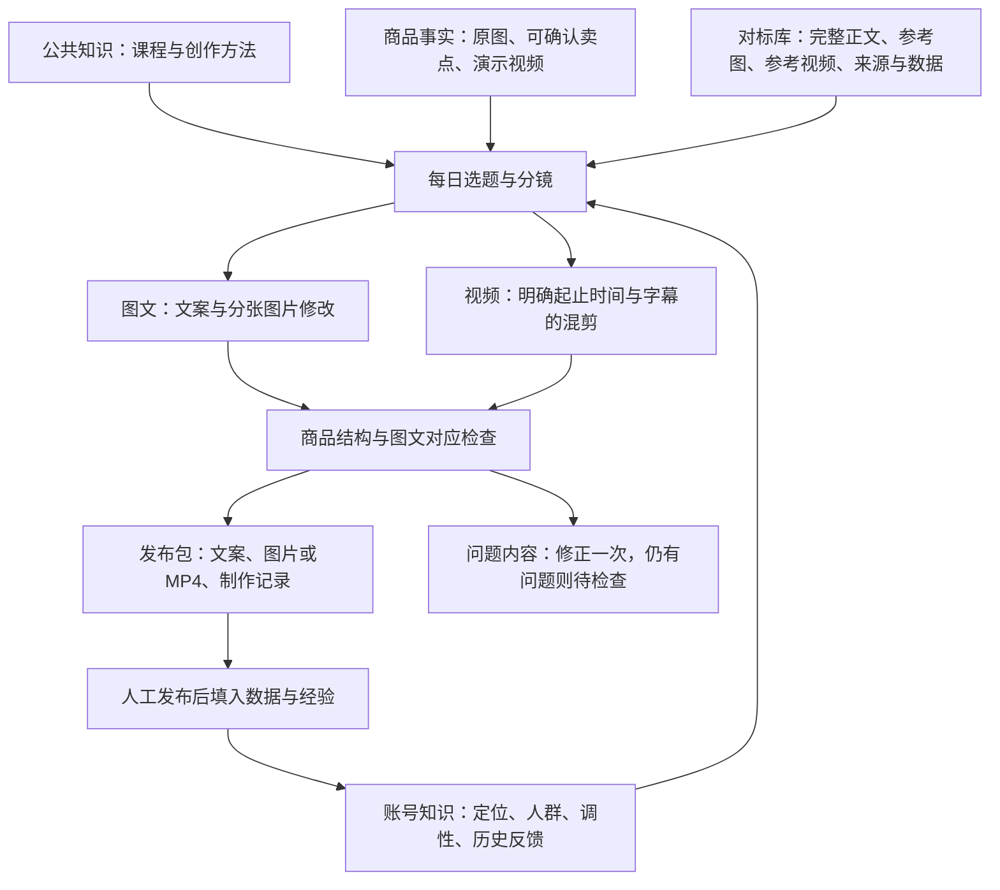

# 拼豆笔账号内容工厂

入口：小红书运营 → 拼豆笔｜每日内容案例 → 每日内容工厂。

## 知识与素材分层



账号与商品拥有各自的素材关联。同一账号的经验进入该账号后续生成提示词，不写入公共方法库。商品原图定义身份；参考图片学习构图；商品演示视频与用户为当前商品选定的参考视频共同进入 AI 时间轴分析和选段；历史成品用于对照和去重，不重新当作商品原始事实。参考视频的正文和标签只提供线索，卖点必须由商品事实或带素材 ID、时间点的可见画面证据支持。

## 当前拼豆笔案例

从工作区已有的 `output/bead_pen_20260918` 项目整理，原文件保留：

- 商品原图12张。
- 同款商品演示原视频1条，约83秒，保留原笔记来源。
- 原笔记正文及互动快照1份；其采集数据不足以证明是爆款，因此作为用户指定对标保存。
- 历史图文3篇及3张配图、历史视频3条，已形成6份独立发布包。
- 商品信息、旧分镜和旧生图提示词原文另外存档。

新账号“拼豆工具观察室”是案例工作空间，不需要绑定外部小红书登录。已有的“潮玩666”账号保持自己的资料。

## 日常使用

1. **继续给素材**：选择当前商品，粘贴图文或视频笔记链接，点击“采集并归入当前商品”。系统保存正文、来源与可取得的媒体。也可按分类直接上传图片/视频；在“写注释”中补充动作内容、时间点、卖点或镜头用途。相同文件在同一商品和分类内按SHA256去重。
2. **手动创作**：图片卡片直接打开现有AI图片修改器；视频卡片直接打开现有混剪器。原始素材继续保留。手动工具生成的结果可作为历史成品重新归档。
3. **自动创作**：每日计划可选择商品、北京时间执行小时、图文/视频数量和配图数。视频任务会对每条候选视频生成两页时间轴抽帧，逐条记录最佳镜头和可见卖点，再生成 3 至 8 段、总计 15 至 45 秒的节奏方案；两个参考视频都有可用镜头时会共同参与成片。成片保留候选视频原音，并用新的四角贴纸层覆盖来源角标和水印区域。点击“制作今日内容”可提前执行当天计划，多次点击复用同一天的任务。
4. **拿到成品**：每条任务分别展示进度。全部媒体完成并通过画面检查后显示“待发布”，可下载ZIP或复制文案。视频是实际剪辑出的H.264 MP4，字幕按分镜时间烧录；默认是无原声的字幕版，不生成口播音频。
5. **记录反馈**：发布后填写链接、评分、曝光/阅读/收藏数据及具体经验。链接只用于登记已发布状态，系统不会因此向小红书发帖。

## 每日计划与差异控制

拼豆笔默认从2026-09-19开始，北京时间每天09:00生成1篇图文、1条视频，图文含3张图。

每天轮换“具体困扰、动作演示、结构细节、生活场景、选择顾虑、新手顺序、反差发现、细节补充”切口。规划时读取本账号最近内容和反馈，避免重复标题、首句、场景和分镜。标题相同、正文相似度高于0.85、图片规划完全重复、视频剪辑点完全重复都会被拦截。视频片段逐项校验素材ID、起止范围、时长和区间重叠，实际渲染使用这份剪辑表。

图片对照商品原图检查结构、零件、比例及图文对应；视频对每一个成片片段抽两帧检查新增字幕。发现明确问题自动修正一次，仍有问题保留为“待检查”，不提供发布包。检查依赖视觉模型，成品仍可在页面预览后选择发布。

源视频数量有限时，轮换选题和剪辑点不会无限创造新画面。持续加入新的实际操作片段、不同环境和不同问题的演示，才会扩大内容空间。无需把大量案例一次塞进模型，更不把每天换几个同义词当成不同内容。

## 状态与恢复

`queued → running → ready → published`

异常分支为 `failed`、`interrupted`、`needs_review`。文案分镜、已完成图片、付费记录与结果逐步保存；继续任务复用已完成步骤，失败的模型请求退回对应本地点数。服务重启后运行中的任务标记为中断并退回仍记录为进行中的请求，避免偷偷重复计费。每天的任务由账号、日期、内容类型和序号唯一标识。

服务持续运行时每5秒检查队列。当天执行时间已过但当天尚无任务，服务恢复后补建当天任务；不追补过去多天。若电脑关机则当时不会生成。自动生成使用已配置的文案/图片接口及本地点数规则；额度或接口出错会显示在对应任务上。

本机已设置当前用户登录时隐藏启动服务；浏览器关闭后后台服务继续执行每日计划。Windows计划任务注册返回Access denied，因此实际使用当前用户启动目录快捷方式，未提权修改系统设置。关闭电脑或退出系统登录期间不生成；重新登录后补建当天尚未建立的任务。`install-factory-schedule.ps1 -Remove`可撤销自动启动，在页面关闭“每天自动制作”可暂停生成。

## 实现位置

- `account_factory.py`：账号素材索引、商品与对标关系、每日调度、生成、画面检查、发布包及反馈。
- `seed_bead_factory.py`：已有拼豆笔项目的可重复导入，按现有记录和文件哈希去重。
- `static/web/account-factory.js`、`.css`：账号页面中的每日内容工厂。
- `web_app.py`：服务生命周期与图文/视频笔记采集接口。

公共知识仍在 `Volume/knowledge.db`，账号与工厂数据在 `Volume/xhs_operations.db`；素材保存在 `Volume/Download/账号素材`，发布包保存在 `Volume/Download/账号成品`。不把API密钥写进发布包。

## 可复用的每日规划指令

```text
读取当前账号定位、商品事实、相关对标和最近内容；只用当前商品素材定义外观。
选一个与最近内容不同的具体问题，让标题、开头、配图或视频动作共同回答它。
图文逐张写明作用、机位、光线、生活细节；视频逐段写明素材ID、起止秒数和字幕。
不编造商品参数、亲测经历或画面没有出现的效果。
生成后检查商品结构、动作与字幕对应，问题素材先修正；全部通过后再打包。
```
